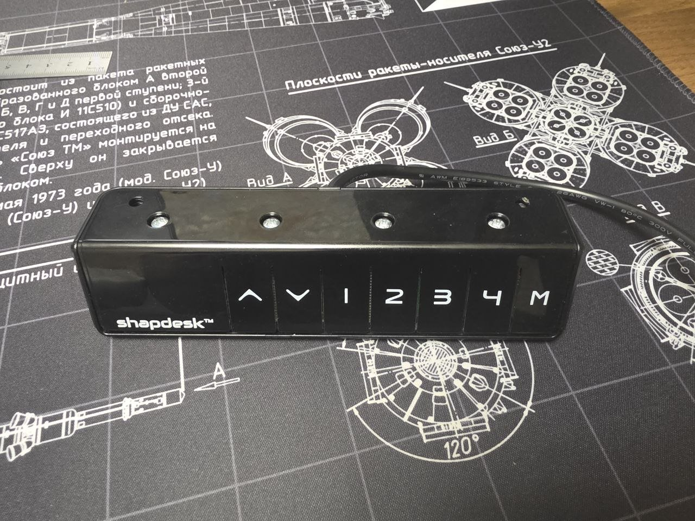
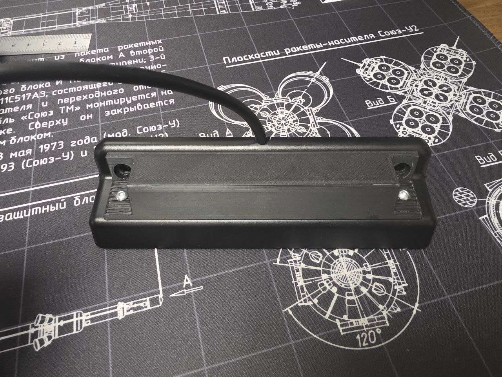
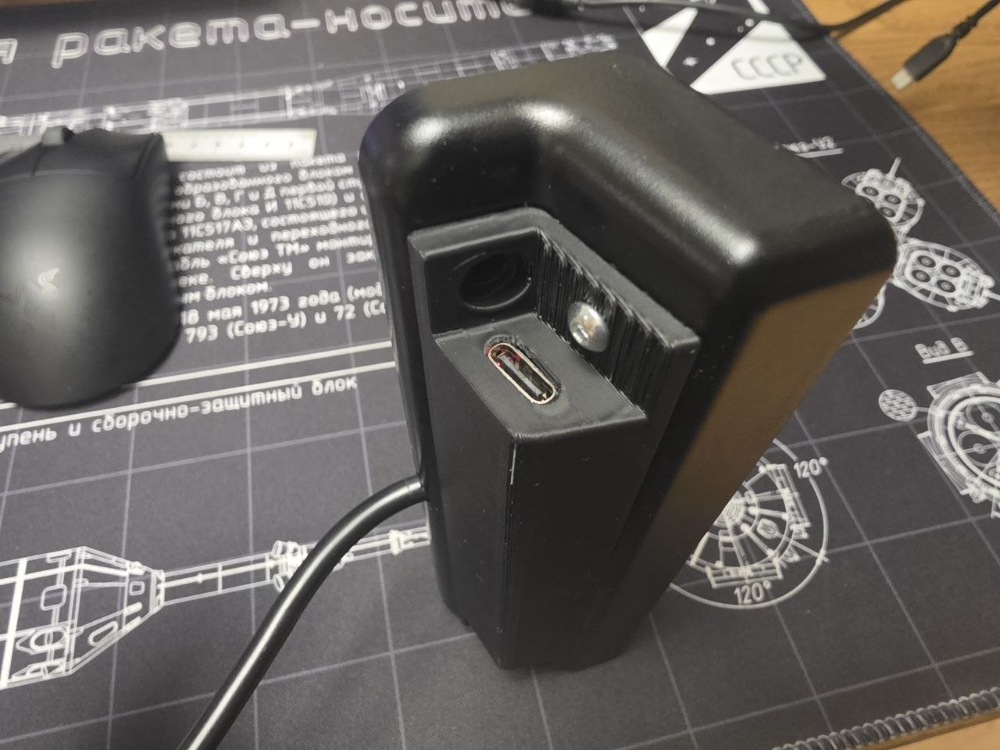
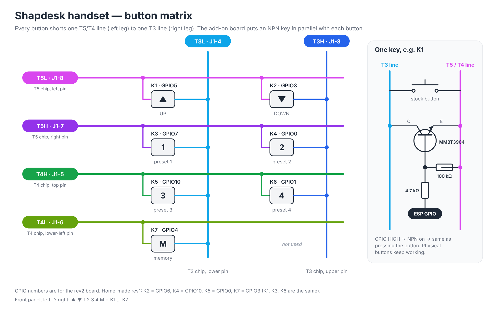
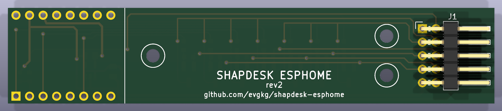
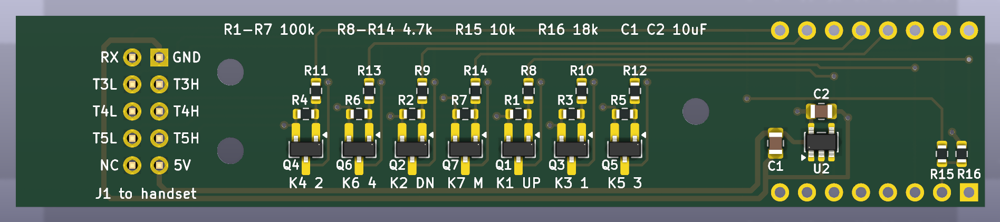
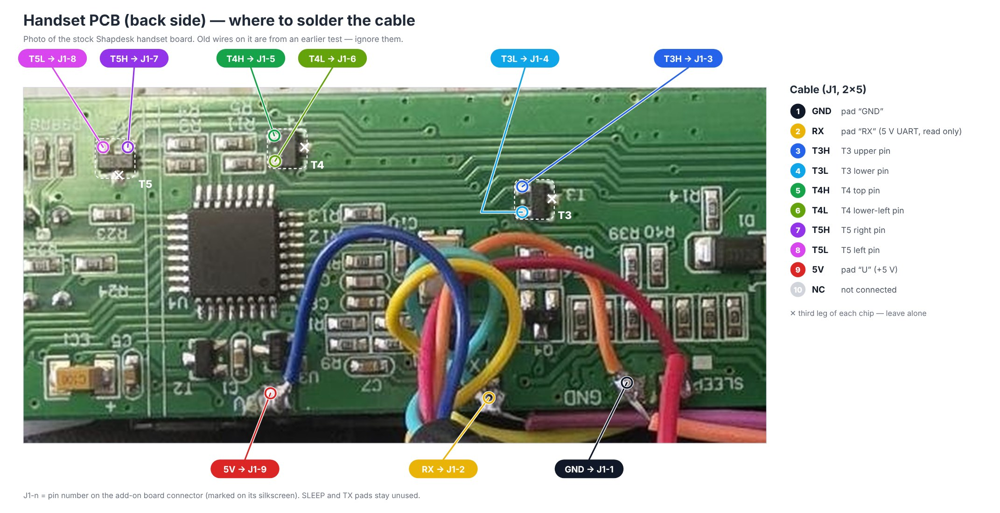
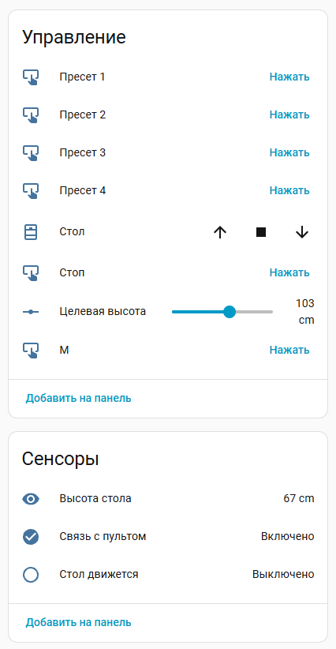

# Shapdesk ESPHome

**English** · [Русский](README.ru.md)

A small add-on that connects a **Shapdesk** standing desk to Home Assistant over Wi-Fi. An ESP32-C3 SuperMini board lives in a little 3D-printed box on the back of the original handset. It presses the handset's buttons for you and reads the desk height from the data the handset sends over UART. In Home Assistant the desk shows up through ESPHome: raise and lower it, send it to a height, recall presets 1–4 and press M.

The buttons on the handset still work as before, and the desk controller's own protections stay in place.

| Handset | Add-on on the back | USB-C for flashing |
|---|---|---|
|  |  |  |

## Contents

- [How it works](#how-it-works)
- [What's where](#whats-where)
- [Hardware](#hardware) · [Board revisions](#board-revisions) · [rev1 issue](#known-issue-rev1-the-desk-moves-down-while-flashing) · [Ordering the PCB](#ordering-the-pcb) · [Parts list](#parts-list)
- [Assembly guide](docs/assembly.md)
- [Firmware](#firmware) · [In Home Assistant](#what-you-get-in-home-assistant) · [Settings](#settings) · [Protection](#protection-against-unwanted-movement) · [First test](#first-test-on-the-desk) · [Tests on a PC](#tests-on-a-pc)

## How it works

The handset's buttons are wired as a matrix: each button connects one of the **T5/T4** lines to one of the **T3** lines. T3, T4 and T5 are three small SOT-23 parts on the handset board, and their legs are handy places to solder to. The add-on has a transistor across each button. When the ESP switches a transistor on, it shorts the button, and the handset can't tell that apart from a finger press.



The handset also keeps sending data on its **RX** line (5 V UART, 9600 8N1): the desk position and what's on the display. The add-on only listens; it never sends anything to the handset.

| Key | Button | GPIO on rev2 | GPIO on rev1 |
|---|---|---:|---:|
| K1 | ▲ up | 5 | 5 |
| K2 | ▼ down | **3** | **6** |
| K3 | preset 1 | 7 | 7 |
| K4 | preset 2 | **0** | **10** |
| K5 | preset 3 | **10** | **0** |
| K6 | preset 4 | 1 | 1 |
| K7 | M | **4** | **3** |
| UART RX | handset data, through a 10k/18k divider | **6** | **4** |
| USB | logs and flashing | 18/19 | 18/19 |

Each GPIO drives an MMBT3904 transistor through a 4.7 kΩ resistor, and a 100 kΩ resistor from base to emitter keeps the transistor off until the GPIO is set up. GPIO2/8/9/20/21 are free. The add-on runs off the handset's 5 V through an ME6211 3.3 V regulator; you can plug in USB at the same time.

## What's where

```
shapdesk.yaml              ESPHome config (settings at the top)
components/shapdesk/       ESPHome component in C++; the main logic doesn't depend on ESPHome
tests/                     PC tests: handset data parsing, height, moving to a height
hardware/pcb/              rev2 board in KiCad 10, Gerber files, make_fab.bat
hardware/enclosure/        enclosure and connector retainer (STL and STEP)
hardware/bom.csv           parts list
docs/assembly.md           step-by-step build
docs/images/               photos and diagrams
```

## Hardware

### Board revisions

| | rev1 | rev2 (this repository) |
|---|---|---|
| Made | at home, single layer with wire jumpers | by a PCB factory, 2 layers, solder mask, silkscreen |
| Keys K1…K7 | GPIO 5, 6, 7, 10, 0, 1, 3 | GPIO 5, 3, 7, 0, 10, 1, 4 |
| UART RX | GPIO4 | GPIO6 |
| In the firmware | `board_revision: "1"` | `board_revision: "2"` |

Only rev2 files are published. rev1 is mentioned here because the firmware still supports it.

> **rev2 hasn't been ordered or tested in hardware yet.** The circuit is the same as on the working rev1, but the board layout and the GPIO assignment are new.

### Known issue (rev1): the desk moves down while flashing

On the ESP32-C3, **GPIO6** has a weak internal pull-up switched on during reset and in the bootloader (ESP32-C3 datasheet, table 2-1, the note about `EFUSE_DIS_PAD_JTAG`). On rev1 that GPIO presses "down". While the chip sits in the bootloader — a few seconds when you flash over USB — the pull-up turns the transistor on and **the desk drives down**. The firmware can't do anything about it, because it isn't running yet.

- **Fixing rev1:** solder a **4.7 kΩ resistor between GPIO6 and GND**. It overpowers the pull-up, so "down" stays released. Until you do, unplug the cable from J1 before flashing, or at least make sure the desk can't hit anything.
- **On rev2** the keys use GPIO 0, 1, 3, 4, 5, 7 and 10, none of which has a pull-up at reset. UART RX moved to GPIO6, where the pull-up doesn't matter. The GPIOs are assigned in the order that keeps the board traces straight. The firmware is set up for rev2 by default (`board_revision: "2"`).

With the wrong revision set, the firmware drives the wrong GPIOs: keys get mixed up and the add-on can't see the height. So check the boot log (see below) before the first test on the desk. The firmware turns off the pull-up on whichever GPIO RX is connected to, so even with the wrong revision that pin can't press a button.

### rev2 board

| Top (ESP32-C3 SuperMini and J1) | Bottom (all the small parts) |
|---|---|
|  |  |

Schematic: [`hardware/pcb/shapdesk_rev2_schematic.pdf`](hardware/pcb/shapdesk_rev2_schematic.pdf). KiCad 10 project: `hardware/pcb/shapdesk_rev2.kicad_pro`.

### Ordering the PCB

`hardware/pcb/shapdesk_rev2_gerbers.zip` can be uploaded as is to any PCB maker (JLCPCB, PCBWay, etc.):

- 2 layers, 1.6 mm thick, 91.2 × 18 mm, any mask colour, HASL finish is fine.
- All SMD parts (0603, 0805, SOT-23) are on the bottom side.
- The thinnest track and the smallest gap are 0.25 mm, vias are 0.8/0.4 mm — standard for any PCB maker.

If you change the board, `hardware/pcb/make_fab.bat` rebuilds the Gerber files and the ZIP (needs KiCad 10).

### Parts list

Full list with board references: [`hardware/bom.csv`](hardware/bom.csv).

| Qty | Part | Package | Where |
|---:|---|---|---|
| 1 | ESP32-C3 SuperMini (soldered on the pin headers it comes with) | module | U1 |
| 1 | ME6211C33M5G-N, 3.3 V regulator | SOT-23-5 | U2 |
| 2 | 10 µF ceramic capacitor, 10 V or more | 0805 | C1, C2 |
| 7 | MMBT3904 NPN transistor | SOT-23 | Q1–Q7 |
| 7 | 100 kΩ | 0603 | R1–R7 |
| 7 | 4.7 kΩ | 0603 | R8–R14 |
| 1 | 10 kΩ | 0603 | R15 |
| 1 | 18 kΩ | 0603 | R16 |
| 1 | right-angle pin header 2×5, 2.54 mm | through-hole | J1 |
| 1 + 9 | Dupont 2×5 female housing and crimp contacts | 2.54 mm | cable |
| 9 | thin stranded wire | | cable |
| 3 + 3 | heat-set insert **M2 × 2.5 × 3.2** and **M2 × 8** button-head hex screw (ISO 7380) | | board into the enclosure |
| 2 + 2 | heat-set insert **M3 × 4 × 4** and **M3 × 6** button-head hex screw (ISO 7380) | | enclosure onto the handset |
| 1 + 1 | printed enclosure and connector retainer | FDM | `hardware/enclosure/` |

### 3D-printed parts

`hardware/enclosure/` has STL files for printing and STEP files in case you want to change something:

- `shapdesk_enclosure` — the box, 132 × 25.5 × 14.9 mm. The M2 inserts for the board go into its three standoffs. The two holes in the flange (Ø3.4 mm) take the M3 screws that hold it on the handset.
- `shapdesk_connector_retainer` — a spacer between the Dupont plug and the enclosure wall, so the plug can't work its way off J1.

### Wiring to the handset

Nine wires go from J1 to the handset board: GND, RX and 5 V to the pads at the board edge, and the other six to the legs of T3, T4 and T5, two per part.



The whole build, step by step, is in **[docs/assembly.md](docs/assembly.md)**.

## Firmware

The firmware is ESPHome (`esp-idf` framework) with the logic in its own C++ component. It talks to Home Assistant over the encrypted ESPHome API and is found on the network automatically (mDNS). It can be updated over Wi-Fi and starts a backup access point if your Wi-Fi isn't reachable. No MQTT needed. The code that reads the handset and drives the desk to a height doesn't depend on ESPHome and is covered by tests that run on a PC. The ESPHome version is pinned in `requirements.txt`.

### Install and flash

In PowerShell, in the project folder:

```powershell
python -m venv .venv
.\.venv\Scripts\python -m pip install -r requirements.txt
Copy-Item secrets.example.yaml secrets.yaml
```

Put your Wi-Fi network, a password for over-the-air updates, a password for the backup access point and your own API encryption key into `secrets.yaml`. The template has example values that everyone can see, so replace all of them. To generate a key, check the config and build:

```powershell
.\.venv\Scripts\python -c "import secrets,base64; print(base64.b64encode(secrets.token_bytes(32)).decode())"
.\.venv\Scripts\esphome config shapdesk.yaml
.\.venv\Scripts\esphome compile shapdesk.yaml
```

> **Don't forget `board_revision`** at the top of `shapdesk.yaml`: `"2"` (the default) for the factory board from this repository, `"1"` for a home-made rev1.

The first flash goes over USB (use your own COM port):

```powershell
.\.venv\Scripts\esphome upload shapdesk.yaml --device COM3
.\.venv\Scripts\esphome logs shapdesk.yaml --device COM3
```

On boot the log shows the revision and the GPIOs, for example `Board rev2: K1..K7 = GPIO5/3/7/0/10/1/4, UART RX = GPIO6`.

After that you can update over Wi-Fi:

```powershell
.\.venv\Scripts\esphome upload shapdesk.yaml --device shapdesk.local
```

If `shapdesk.local` can't be found, use the IP address. If the add-on can't join your Wi-Fi, it starts its own access point, `Shapdesk Fallback` (password from `secrets.yaml`): connect to it and pick your network. Before an over-the-air update the add-on releases all buttons. If you ever need to put the ESP into the bootloader by hand, use the BOOT and RESET buttons on the SuperMini.

In Home Assistant, open *Settings → Devices & services*. The add-on shows up there as a discovered ESPHome device; add it and enter the encryption key. If it doesn't show up, add the ESPHome integration by hand with the IP address and port 6053.

### What you get in Home Assistant

The entity names in `shapdesk.yaml` are in Russian; rename them however you like.



- **Высота стола** (desk height) — the current height in centimetres. It's empty while the add-on doesn't know the height yet, and for a short while after you press a preset, because the handset then shows the preset's height instead of the real one.
- **Стол** (desk) — the ↑ and ↓ arrows raise and lower the desk, ■ stops it. The desk keeps moving until you stop it, for 20 seconds at most (`max_hold_ms`). Open the card and there's also a slider in percent: 0 % is the lowest height, 100 % the highest, anything in between is the matching height. At 0 % and 100 % the slider works the same as the ↓ and ↑ arrows.
- **Целевая высота** (target height) — set a height in centimetres and the desk goes up or down to it.
- **Пресет 1–4** and **M** — the same as pressing those buttons on the handset.
- **Стоп** (stop) — lets go of whatever button the add-on is holding and cancels a move to the target height. It doesn't stop a preset move: the desk goes to a preset on its own, nothing is holding a button.
- **Стол движется** (desk moving) and **Связь с пультом** (handset link) — whether the desk is moving right now and whether data is coming from the handset.
- Diagnostics: the height shown on the handset, the position in the handset's own units (hidden by default), how much handset data was accepted and rejected, Wi-Fi signal and uptime.

For automations there's an action, `esphome.shapdesk_press_key`: it presses key `key` (1–7, see the table above) and holds it for `duration_ms` milliseconds, for example `{key: 7, duration_ms: 300}`. The exact action name depends on what the device is called in HA. If the parameters are wrong, nothing is pressed and the reason goes to the log.

### Settings

All settings are in the `substitutions` block at the top of `shapdesk.yaml`.

| Setting | Default | What it does |
|---|---:|---|
| `board_revision` | 2 | Board revision: 1 = home-made rev1, 2 = factory rev2 |
| `k3_name`…`k6_name` | Пресет 1…4 | Names of the preset buttons; check which preset is which on your handset |
| `max_hold_ms` | 20000 | The longest "up", "down" and M can be held, ms (1…120000) |
| `pulse_ms` | 300 | Length of a short press, ms (1…500) |
| `start_timeout_ms` | 3000 | How long to wait for the desk to start moving, ms (1…30000) |
| `min_height`, `max_height` | 66, 131 | Lowest and highest height the add-on will drive to, cm (50…150) |
| `tolerance` | 1 | How close to the target counts as arrived, cm (0…5) |
| `stop_offset` | 1 | How far before the target to let go of the button, cm (0…5) |
| `adapt_offset` | true | Tune `stop_offset` automatically |

Why `stop_offset` exists: when the button is let go, the desk keeps moving a little. So to stop exactly at the target, the button has to be let go a bit early. With `adapt_offset` on, after every move the firmware checks how far the desk coasted and nudges `stop_offset` towards it: new value = 0.75 × old + 0.25 × this time's coast (kept within 0…5 cm). Up and down are tracked separately and start again from `stop_offset` after a reboot. Moves where something went wrong (handset data dropped out, the desk went the wrong way, it coasted more than 5 cm) are left out.

### Protection against unwanted movement

What the firmware does so the desk doesn't move by itself:

- **Nothing is pressed on power-up or reboot.** The first thing the firmware does on boot is release every button, before it even joins Wi-Fi. Before the firmware starts, resistors on the board keep the transistors off.
- **Only one button at a time**, with at least 50 ms between presses. If a command to press another button arrives while one is held, the add-on lets go of everything and ignores that command — just send it again.
- **No button is held longer than allowed.** A separate hardware timer watches this, so the button is released even if the main program hangs or is busy. Presets are held for at most 500 ms; "up", "down" and M for at most `max_hold_ms`. Sending the same command again doesn't extend the time.
- **Moving to a height** only starts if the add-on knows the current height for sure. The desk is stopped if the handset goes quiet for more than half a second, the desk moves the wrong way, it doesn't start within `start_timeout_ms`, it reaches a height limit, or the connection to Home Assistant or Wi-Fi drops.
- **Without handset data** you can only move the desk up and down by hand, within `max_hold_ms`. Sending it to a height isn't possible.
- **The desk won't go past `min_height` and `max_height`**, but it can always move back away from a limit.

What the firmware can't do:

- "Stop" only releases buttons the add-on pressed itself. If someone is holding a button on the handset, it can't do anything about it. And if a short preset press made the handset drive the desk to the preset on its own, "Stop" won't stop that — stop it from the handset.
- A burnt-out transistor or a completely frozen ESP is beyond what software can protect against. Always keep the handset within reach.

### First test on the desk

1. Before the first move, use a scope or logic analyser to check that the add-on presses nothing on power-up, reboot and Wi-Fi reconnect, and that a press ends on its own when the time runs out. Check that the handset buttons work as before and that Home Assistant shows the height.
2. Press M briefly (300 ms). Then "up" and "down", 300 ms each, one at a time with a pause in between. Check that the button is released by "Stop", by losing Wi-Fi or Home Assistant, when the time runs out and before an over-the-air update.
3. With the desk standing still, check that the height in Home Assistant matches the handset display. Recall a preset: the preset height the handset flashes on its display must not end up in *Высота стола*.
4. Clear the space above and below the desk and set a height 2–3 cm above or below the current one. Note how long the desk takes to start (the handset wakes up first) and how far it coasts; adjust `start_timeout_ms` and `stop_offset` if needed. Try both directions and the height limits with a hand on the handset.
5. Work out which preset is on which button and name them in `k3_name`…`k6_name`. There's no need to hold preset buttons for long.

### Tests on a PC

You need a C++20 compiler, CMake and Ninja:

```powershell
cmake -S . -B build/host -G Ninja
cmake --build build/host
ctest --test-dir build/host --output-on-failure
```

The tests cover parsing the handset data, checksums, working out the height, rejecting broken data and the counters, and they run moves to a height against a simulated desk. On Windows without a C++ compiler you can `pip install ziglang` and point CMake's `CMAKE_CXX_COMPILER` at `zig.exe`, with `CMAKE_CXX_COMPILER_ARG1=c++`.

## License

[MIT](LICENSE)
