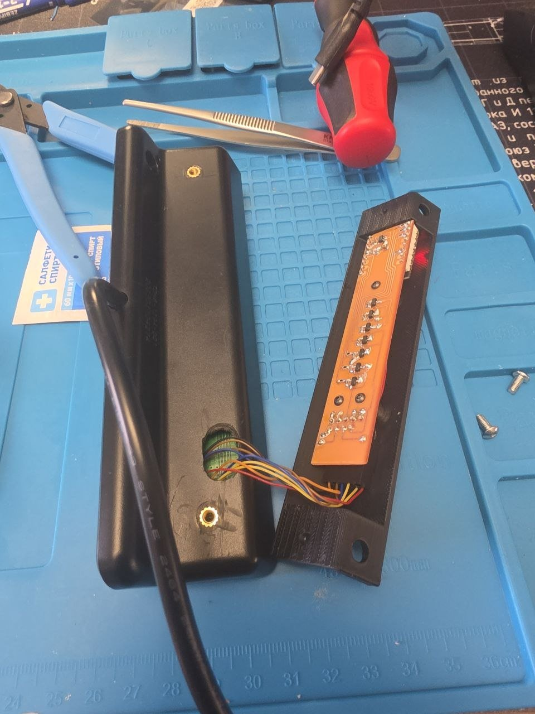
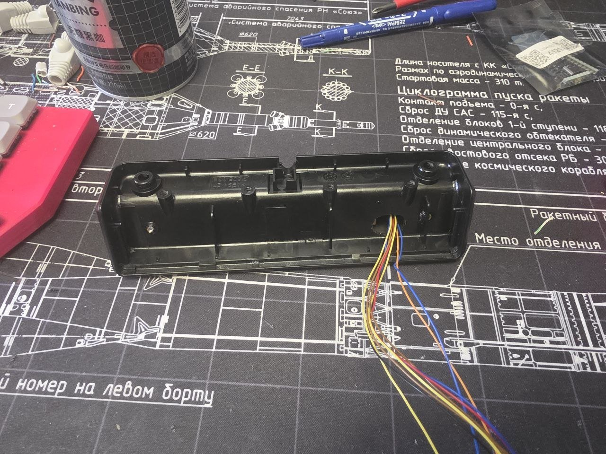

# Assembly guide

**English** · [Русский](assembly.ru.md) · [Back to README](../README.md)

This guide is for the **rev2** board from `hardware/pcb/`. Parts list: [`hardware/bom.csv`](../hardware/bom.csv).

You'll need a soldering iron with a fine tip, flux, tweezers, a multimeter, a heat-set insert tip (a plain tip works too), a Dupont crimper and a drill.

## 1. Print the parts

Print `hardware/enclosure/shapdesk_enclosure.stl` and `shapdesk_connector_retainer.stl`. Any FDM plastic that takes heat-set inserts will do (PLA, PETG and so on).

Melt the three **M2 × 2.5 × 3.2** inserts into the board standoffs inside the enclosure.

## 2. Solder the board

All the small parts go on the **bottom** side. The silkscreen there shows the part numbers, the values (`R1-R7 100k  R8-R14 4.7k  R15 10k  R16 18k  C1 C2 10uF`) and which button each transistor presses (`K1 UP` … `K7 M`).

1. Start with the power supply: U2 (ME6211, SOT-23-5), C1 and C2.
2. Resistors R1–R16. The 100 kΩ and 4.7 kΩ ones are easy to mix up, so keep them in separate piles.
3. Transistors Q1–Q7 (MMBT3904).
4. With a multimeter, check that 5 V, 3.3 V and GND aren't shorted to each other.
5. **Top side:** the ESP32-C3 SuperMini on the pin headers it comes with (USB-C facing away from J1), and the right-angle header J1 (bent pins pointing to the board edge, as drawn on the silkscreen).

## 3. Flash the firmware

Flash the board over USB **while it's not connected to the handset**. Check that `shapdesk.yaml` has `board_revision: "2"` (it's the default) and follow [Install and flash](../README.md#install-and-flash). On boot the log should show:

```
Board rev2: K1..K7 = GPIO5/3/7/0/10/1/4, UART RX = GPIO6
```

## 4. Prepare the handset

Open the handset. The wires leave it through a hole in the back cover, which the enclosure later covers up. Melt two **M3 × 4 × 4** inserts into the back cover opposite the holes in the enclosure's flange — to mark the spots, just hold the enclosure against the cover.

| Back cover with the hole and inserts, board in the enclosure | Wires coming out through the back cover |
|---|---|
|  |  |

## 5. Solder the wires to the handset board

There are nine wires: three go to the GND, RX and 5 V pads at the board edge, and the other six go to T3, T4 and T5, two per part. The photo shows which legs. Leave the third leg of each part alone.


How the button matrix works:


Tips:

- Tin the legs first, then hold the tinned wire against them and touch it briefly with the iron.
- Tack the wires to the board with hot glue or tape so they don't pull on the tiny SOT-23 legs.
- RX is a 5 V signal, but the divider is already on the add-on board, so the wire goes straight to J1-2.

## 6. Make the cable

Crimp Dupont contacts onto the wires and push them into the 2×5 housing by J1 number:

| J1 | Wire | | J1 | Wire |
|---:|---|---|---:|---|
| 1 | GND | | 2 | RX |
| 3 | T3H | | 4 | T3L |
| 5 | T4H | | 6 | T4L |
| 7 | T5H | | 8 | T5L |
| 9 | 5V | | 10 | not used |

The same labels are printed on the bottom of the board next to J1.

Before plugging it in, check each housing position for continuity to its point on the handset board, and check that neighbouring positions aren't shorted.

## 7. Put it in the enclosure

1. Plug the cable onto J1 and slide the retainer in between the plug and the enclosure wall.
2. Screw the board into the enclosure with three M2 × 8 button-head screws.
3. Close the handset and screw the enclosure onto it with two M3 × 6 button-head screws.

## 8. Test it

Add the add-on to Home Assistant and go through the [first test on the desk](../README.md#first-test-on-the-desk). Start with short presses and keep the handset within reach.

## If something doesn't work

- **No height, "Связь с пультом" (handset link) is off:** check `board_revision` and the RX and GND wires. With the board unplugged from the handset, J1-2 to J1-1 should read about 28 kΩ (that's the 10k + 18k divider).
- **One or more buttons do nothing:** the same wires go to several buttons, so look for the shared one. For example, if ▼ and 2 don't work, check T3H; if 1 and 2 don't work, check T5H. Re-solder that wire and check its crimp.
- **The desk moves down while flashing:** that's the rev1 issue, see the [README](../README.md#known-issue-rev1-the-desk-moves-down-while-flashing).
